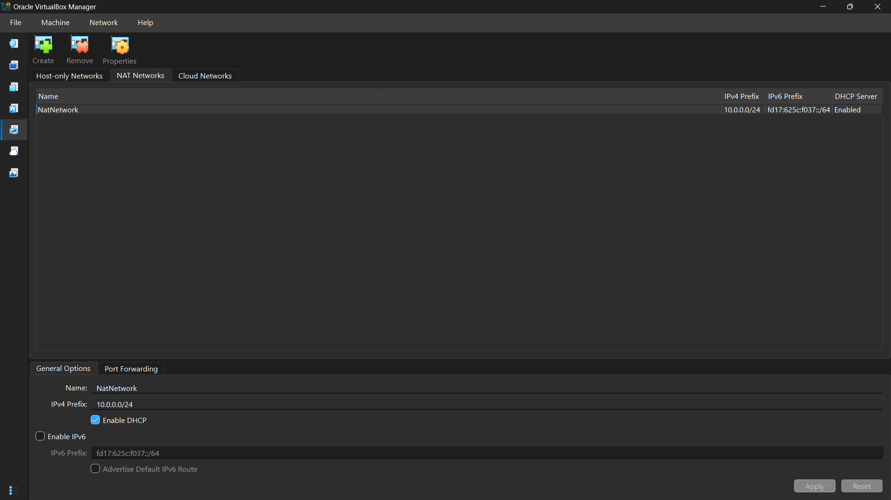
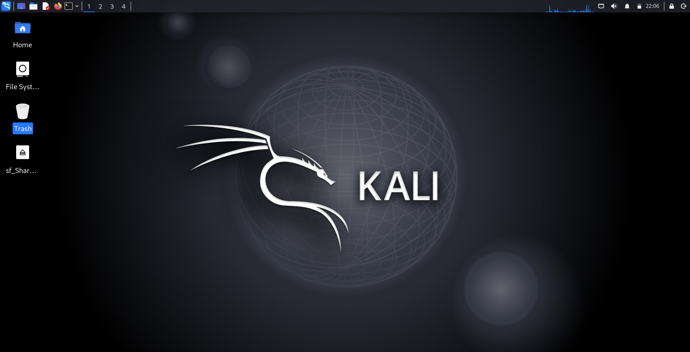
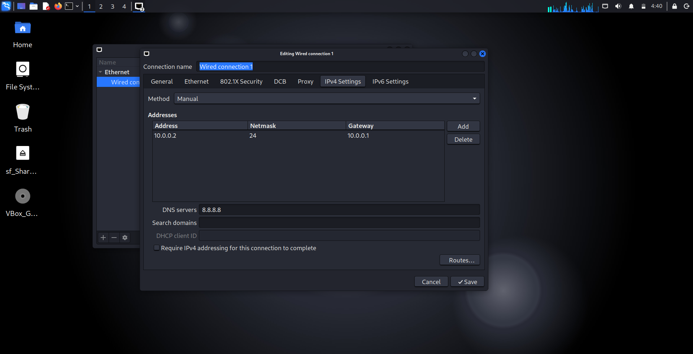
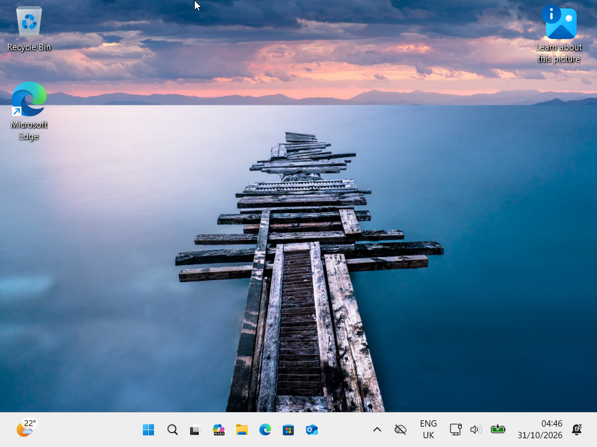
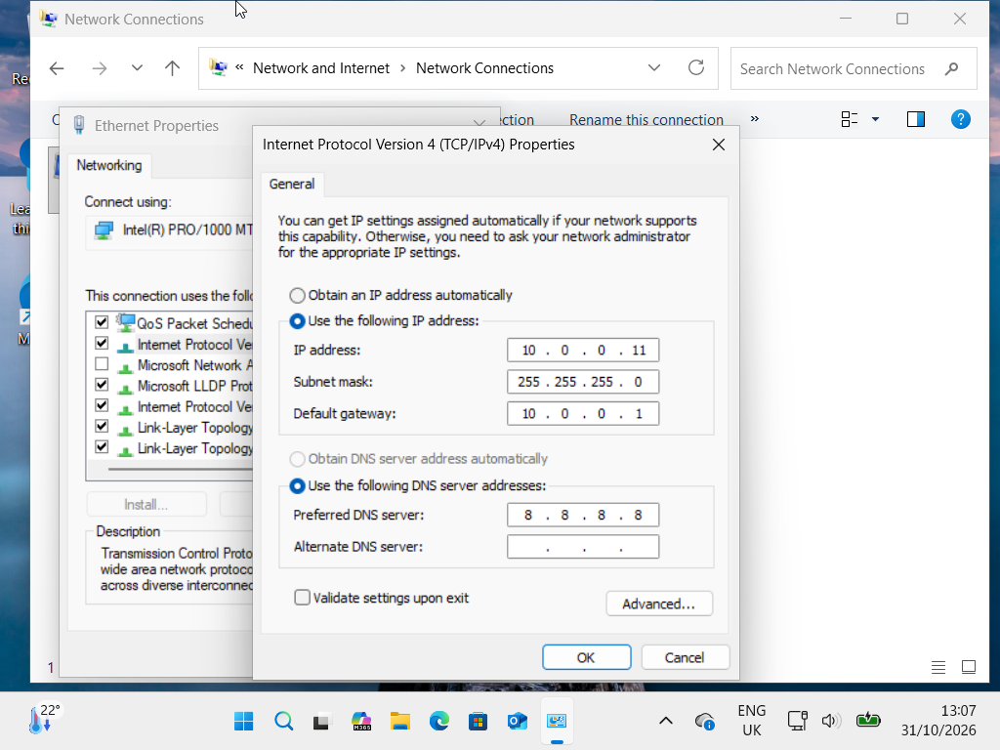
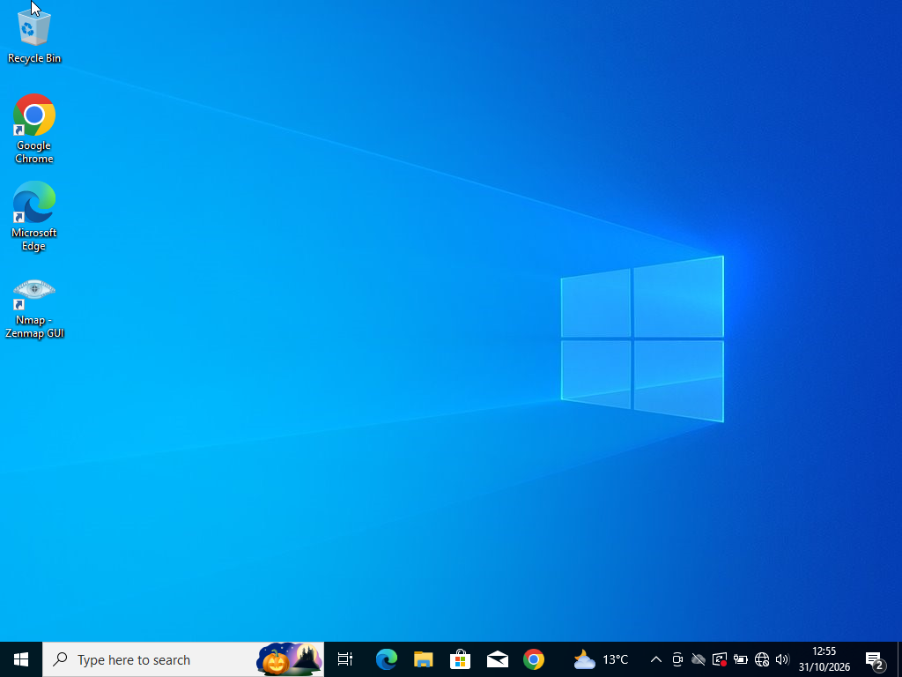
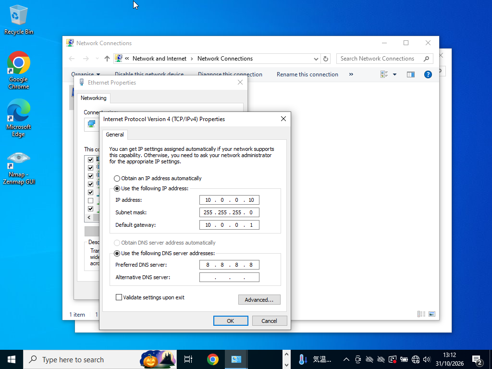

## Networkwalks-B084-week1-Cybersecurity-Target-Machines-Lab-Extra

<div align="center">

# 🔐 Cybersecurity Lab Environment Setup

**Building an isolated virtual lab for penetration testing and ethical hacking practice**
</div>

<p align="center">
  
  
  
  
  
  
  
  
  
  
  
</p>

---

## 📌 Project Overview

This project focuses on setting up a **virtual cybersecurity and penetration-testing laboratory** using VirtualBox, Kali Linux, Windows 11, Windows 10 and Android 9.

The purpose of the lab is to create a controlled environment where cybersecurity tools, network scanning, reconnaissance, vulnerability assessment and other security-testing activities can be performed safely and repeatedly.

The lab is configured on a private virtual network and has incorporated additional machines used as targets for authorized security testing.

---


## 🎯 Objectives

The main objectives of this project are to:

- Install and configure VirtualBox.
- Install/import Kali Linux as a virtual machine.
- Create a private **NAT Network** for the cybersecurity lab.
- Configure network connectivity for Kali Linux.
- Assign a consistent IP address to the Kali VM.
- Verify network connectivity and DNS resolution.
- Take a clean VM snapshot for recovery.
- Install and configure Windows 11, Windows 10 and Android 9.
- Document the complete setup process.
- Prepare the environment for future cybersecurity projects.

---

## 🛡️ Purpose of the Lab

The lab provides an isolated and controlled environment for cybersecurity learning and authorized security testing.

It can be used for activities such as:

- Network reconnaissance
- Port scanning
- Vulnerability assessment
- Packet analysis
- Web security testing
- Exploitation practice
- Security-tool experimentation

⚠️ **Important:** This laboratory must only be used for systems that you own or have explicit permission to test. Do not use the lab or its tools to attack unauthorized systems.

---

## 🏗️ Lab Architecture


Windows 11, Windows 10 and Android 9 have been added as target machines to the same virtual network along side the Kali Linux attack machine for future projects.

---

## ⚙️ Lab Configuration

| 🧩 Component       | ⚙️ Configuration   |
| ------------------ | ------------------  |
| 🖥️ Host OS         | Windows 11 Pro     |
| 🧠 Host RAM        | 16 GB              |  
| ⚡ Processor       | AMD Ryzen 3        |
| 🧰 Hypervisor      | VirtualBox 7.2     |
| 🐉 Security OS     | Kali Linux 2026.2  |
| 🧠 Kali RAM        | 2048 MB            |
| 🌐 Virtual Network | NAT Network        |
| 📡 Network Address | 10.0.0.0/24        |
| 🐧 Kali IP Address | 10.0.0.2/24        |
| 🚪 Default Gateway | 10.0.0.1           |
| 🌍 DNS Server      | 8.8.8.8            |
| -------------------| ------------------  |
| 🐉 Security OS     | Window 11_25H2     |
| 🧱 Win 11 RAM      | 4096 MB            |
| 🌐 Virtual Network | NAT Network        |
| 📡 Win 11 Address  | 10.0.0.11/24       |
| ------------------ | ------------------  |
| 🐉 Security OS     | Windows 10         |
| 💻 Win 10 RAM      | 4096 MB            |
| 🌐 Virtual Network | NAT Network        |
| 📡 Win 10 Address  | 10.0.0.10/24       |
| ------------------ | ------------------  |
| 🐉 Security OS     | Android-x86_64-9.0 |
| 📱 Kali RAM        | 2048 MB            |
| 🌐 Virtual Network | NAT Network        |
| 📡 And9 Address    | 10.0.0.9/24        |
| ------------------ | ------------------  |
| 🔮 Future VM Range | 10.0.0.12–10.0.0.99|


---

# 🪜 Lab Setup Procedure

## Step 1. Install WinRAR

WinRAR was installed to extract the Kali Linux virtual-machine package.

**Tool:** WinRAR

---

## Step 2. Install VirtualBox

VirtualBox was installed as the hypervisor.

---

## Step 3. Create the NAT Network

A dedicated NAT Network was created in VirtualBox.

Configuration:
Network Name: NatNetwork
IPv4 Prefix:  10.0.0.0/24
DHCP:         Enabled
IPv6:         Disabled




A **NAT Network** was selected because multiple virtual machines connected to the same NAT Network can communicate with one another while also having outbound network connectivity.

This will allow future attacker and target VMs to communicate within the lab.


---

## Step 4. Import Kali Linux

The Kali Linux virtual machine was downloaded from the official Kali Linux website and imported into VirtualBox.

The VM network adapter was configured as follows:

```text
Adapter 1
Attached to: NAT Network
Network:     NatNetwork
Adapter Type: Intel PRO/1000 MT Desktop
```

The VM was allocated:

```text
RAM: 2048 MB
```


A shared folder was also configured for transferring required files between the host operating system and the Kali VM.


---

## Step 5. Configure the Kali Linux Network

The Kali Linux network configuration was checked and configured with a consistent IPv4 address.

Example configuration:

```text
IP Address: 10.0.0.2
Subnet Mask: 255.255.255.0
Gateway: 10.0.0.1
DNS: 8.8.8.8
```

A consistent IP address makes it easier to document the lab and reference the Kali machine in future exercises.




---

## Step 6. Import Windows 11 

The Windows 11 virtual machine was downloaded from the official Windows website and imported into VirtualBox.

The VM network adapter was configured as follows:

```text
Adapter 1
Attached to: NAT Network
Network:     NatNetwork
Adapter Type: Intel PRO/1000 MT Desktop
```

The VM was allocated:

```text
RAM: 4096 MB
```



A shared folder was also configured for transferring required files between the host operating system and the Windows 11 VM.


---

## Step 7. Configure the Windows 11 Network

The Windows 11 network configuration was checked and configured with a consistent IPv4 address.

Example configuration:

```text
IP Address: 10.0.0.11
Subnet Mask: 255.255.255.0
Gateway: 10.0.0.1
DNS: 8.8.8.8
```

A consistent IP address makes it easier to document the lab and reference the Windows 11 in future exercises.




---

## Step 8. Import Windows 10 

The Windows 10 virtual machine was downloaded from the official Windows website and imported into VirtualBox.

The VM network adapter was configured as follows:

```text
Adapter 1
Attached to: NAT Network
Network:     NatNetwork
Adapter Type: Intel PRO/1000 MT Desktop
```

The VM was allocated:

```text
RAM: 4096 MB
```


A shared folder was also configured for transferring required files between the host operating system and the Windows 10 VM.


---

## Step 9. Configure the Windows 10 Network

The Windows 10 network configuration was checked and configured with a consistent IPv4 address.

Example configuration:

```text
IP Address: 10.0.0.10
Subnet Mask: 255.255.255.0
Gateway: 10.0.0.1
DNS: 8.8.8.8
```

A consistent IP address makes it easier to document the lab and reference the Windows 10 in future exercises.




---

## Step 10. Import Android 9 

The Android 9 virtual machine was downloaded from the official Windows website and imported into VirtualBox.

The VM network adapter was configured as follows:

```text
Adapter 1
Attached to: NAT Network
Network:     NatNetwork
Adapter Type: Intel PRO/1000 MT Desktop
```

The VM was allocated:

```text
RAM: 4096 MB
```


A shared folder was also configured for transferring required files between the host operating system and the Android 9 VM.


---

## Step 11. Configure the Android 9 Network

The Android 9 network configuration was checked and configured with a consistent IPv4 address.

Example configuration:

```text
IP Address: 10.0.0.9
Subnet Mask: 255.255.255.0
Gateway: 10.0.0.1
DNS: 8.8.8.8
```

A consistent IP address makes it easier to document the lab and reference the Android 9 in future exercises.


---
## Step 12. Create a Clean VM Snapshot

After completing the initial configuration, a VirtualBox snapshot was created.

Example snapshot name:

```text
Clean Win 11  - Network Setup
```

The snapshot represents the clean baseline of the laboratory.

If a future exercise changes or damages the VM configuration, the machine can be restored to this baseline.


---

# 🔎 Lab Verification

| ✅ Test                        | 🧾 Command                      | 🎯 Expected Result              |
| ----------------------------- | ------------------------------- | ------------------------------- |
| 🌐 Check IP address           | `ip a`                          | Correct Kali IP displayed       |
| 📡 Test gateway               | `ping 10.0.0.1`                 | Successful replies              |
| 🌍 Test Internet connectivity | `ping 8.8.8.8`                  | Successful replies              |
| 🔎 Test DNS resolution        | `nslookup networkwalks.com`     | Domain resolves                 |
| 🧰 Verify Nmap                | `nmap --version`                | Nmap version displayed          |
| 🖥️ Host Discovery Test        | `nmap -sn 10.0.0.0/24`          | Successful discovery            |
| 🔄 Verify snapshot            | Restore snapshot and run `ip a` | Baseline configuration restored |

### Example Results

```text
IP Address:
10.0.0.2/24

Gateway:
10.0.0.1

DNS:
8.8.8.8
```

---

# 🐞 Problems Encountered & Solutions

Documenting problems is an important part of the project.

## Problem 1. Internet Connectivity After Static IP Configuration

After manually configuring the IPv4 settings, Internet connectivity may fail depending on the Kali/NetworkManager configuration.

One workaround used during this lab was:

```bash
sudo nmcli connection modify "Wired connection 1" ipv4.dad-timeout 0
```

The network connection was then restarted/rebooted and connectivity was tested again.


---

## Problem 2. Ping Connectivity with Windows 11 and Windows 10

After configuring the IPv4 settings, ping connectivity failed between that Kali and the Windows VMs.

The issue was resolved by enabling "File and Printer Sharing (Echo Request for - IPv4-in)":

  1. Control Panel > System and Security > Windows Defender Firewall.
  2. Advanced settings > Inbound Rules.
  3. File and Printer Sharing (Echo Request for - IPv4-in).
  4. Enable rule for both Domain and Privat Profile.

After enabling the IPv4 for Inbound Rules on Windows Defender Firewall the ping connectivity was successful.


---

# 💡 What I Learned

Through this project, I learned how to create and configure a virtual environment for cybersecurity practice.

The most important concepts I learned include:

### 1. NAT vs NAT Network

A standard NAT configuration and a NAT Network serve different purposes.

A NAT Network allows multiple VMs connected to the same virtual network to communicate with one another while providing network address translation for external connectivity.

This makes it useful for building a multi-machine cybersecurity laboratory.

### 2. Virtual Machine Networking

I learned how VirtualBox virtual network adapters connect virtual machines to different types of networks and how network configuration affects communication between machines.

### 3. Static IP Configuration

I learned how to configure and verify IPv4 addressing, subnet masks, gateways and DNS settings in Kali Linux.

### 4. VM Snapshots

I learned that a clean snapshot should be created **before performing risky or experimental activities**.

This provides a known-good recovery point for future cybersecurity exercises.

### 5. Default Security Posture of Windows

I learned how Windows treat unsolicited incoming network traffic with a "deny" policy to prevent unauthorized scanning and mapping of device on a network.

### 6. Documentation

I learned that documenting commands, configuration, screenshots, problems and solutions is an important part of a professional cybersecurity project.

---

# 🔐 Security & Ethical Use

This laboratory is intended strictly for education purposes only.

---

# 🔗 Tools & Resources

- **WinRAR:** [https://www.win-rar.com/download.html?&L=0](https://www.win-rar.com/download.html?&L=0)
- **VirtualBox:** [https://virtualbox.org/wiki/Downloads](https://virtualbox.org/wiki/Downloads)
- **Kali Linux:** [https://kali.org/get-kali](https://kali.org/get-kali)
- **Window 11:** [https://www.microsoft.com/ja-jp/software-download/windows11](https://www.microsoft.com/ja-jp/software-download/windows11)
- **Window 10:** [https://www.microsoft.com/ja-jp/software-download/windows10](https://www.microsoft.com/ja-jp/software-download/windows10)
- **Android-x86:** [https://sourceforge.net/projects/android-x86/files/Release%209.0/](https://sourceforge.net/projects/android-x86/files/Release%209.0/)

---

# 👤 Author

**Ebenezer Twumasi Frimpong**\
Cybersecurity Intern B084

LinkedIn: [https://linkedin.com/in.ebenezer-twumasi-frimpong-0689143b8/](https://www.linkedin.com/in/ebenezer-twumasi-frimpong-0689143b8/)

---

## 📌 Project Information

**Program Name:** Cybersecurity at Networkwalks | **Week:** 01 | **Extra** | **Project:** Cybersecurity & Pentesting Lab Setup | **Target Machines** | **Repository:** GitHub
